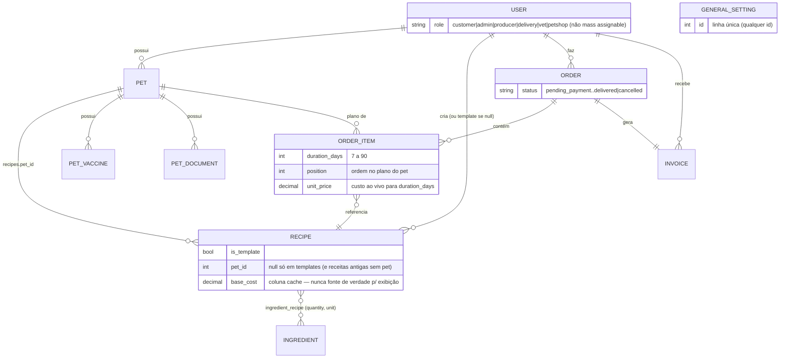

# Modelo de Domínio

O GoodFood System é uma plataforma de alimentação natural para pets: tutores cadastram seus pets, cada um com as suas receitas personalizadas, e fazem pedidos que funcionam como planos alimentares (uma ou mais receitas em sequência por pet, cada uma com a sua duração). A empresa administra catálogo, produção e entregas.

## Entidades

```text
User (tutor ou admin)
 ├── Pet (1:N)
 │    └── Recipe (1:N via recipes.pet_id — todo pet tem ao menos uma receita)
 ├── Recipe (1:N via user_id — autor; templates do catálogo não têm pet)
 └── Order (1:N — o plano alimentar)
      ├── OrderItem (1:N — Pet + Recipe + duration_days + position)
      └── Invoice (1:1)

Ingredient
 └── Recipe (N:M via ingredient_recipe, pivot com `quantity` e `unit`)

GeneralSetting (linha única — parâmetros globais de precificação)
```

> O antigo módulo de assinaturas foi removido. As tabelas foram apenas renomeadas para `legacy_subscriptions` e `legacy_subscription_recipes` (migration `2026_10_22_000002_archive_subscriptions_tables`), preservando os dados para consulta direta no banco — nenhum model ou endpoint as usa.

### Diagrama ER



> `GeneralSetting` não tem chave estrangeira com nenhuma outra entidade — é lido em memória por `RecipeCostCalculatorService` para todo cálculo de custo, mas não referencia nem é referenciado por linhas específicas.

### User
- Campos principais: `name`, `email`, `password`, `phone`, endereço desmembrado (`street`, `number`, `complement`, `neighborhood`, `city`, `state`, `zipcode`), `whatsapp_notifications`.
- **`role`**: `customer` (padrão) | `admin` | `producer` | `delivery` | `vet` | `petshop`. O campo **não é mass assignable** — é atribuído explicitamente no código (registro público sempre cria `customer`).
- **`onboarding_dismissed_at`** (timestamp, nullable): quando o cliente dispensou o guia de primeiros passos do dashboard. Não é mass assignable — só os endpoints `/onboarding/dismiss` alteram.
- Helpers: `isAdmin()`, `isCustomer()`.

### Pet
- Pertence a um `User`. Campos: `name`, `type` (`dog`|`cat`), `sex`, `neutered`, `microchip_number`, `vet_name`, `vet_phone`, `breed`, `weight` (kg), `age` (meses), `birth_date`, `restrictions`, `allergies`, `special_needs`, `photo_url`.
- `recipes` (`hasMany`, via `recipes.pet_id`): as receitas do pet. Todo pet novo nasce com uma receita — `POST /pets` exige o objeto `recipe` (montada do zero ou copiada de um template) e cria pet + receita numa transação. Pets antigos, anteriores a essa regra, podem estar sem receita: o dashboard aponta para `first_pet_without_recipe_id`.
- Relações de saúde: `vaccines` (`PetVaccine`) e `documents` (`PetDocument`). `Pet::orders` vem de `order_items.pet_id` (não da coluna legada `orders.pet_id`).
- Foto enviada via `POST /api/pets/upload-photo` (armazenada em `storage/app/public/pets`).

### Ingredient
- Catálogo global (não pertence a usuário). Campos: `name`, `category`, `unit` (kg, g, unit, l), `cost_per_unit`/`unit_cost`, `loss_rate` (fator de perda), `difficulty_multiplier`, `stock_quantity`, `is_active`.
- Somente admins criam/editam/removem; clientes veem apenas os ativos.

### Recipe
- Pode ser **template** (`is_template = true`, criada por admin, sem pet, visível a todos — ponto de partida para a receita do pet) ou **receita de pet** (`pet_id` de um único pet; um pet tem 1..N receitas). Uma receita nunca muda de pet; usar um template cria uma cópia privada para o pet (`RecipeService::copyToPet`).
- Receitas de cliente sem pet só existem como legado da migração `2026_10_22_000001_make_recipes_belong_to_a_single_pet` (que converteu o antigo pivot `pet_recipe` em `recipes.pet_id`, copiando receitas compartilhadas entre pets); ficam ocultas na interface e não afetam o histórico de pedidos.
- Campos: `name`, `description`, `pet_type` (`dog`|`cat`|`all`), `duration_days`, `daily_portions`, `instructions`, `base_cost`, `ingredient_cost`, `is_active`.
- Ingredientes via pivot com `quantity` e `unit`. `base_cost`/`ingredient_cost` são colunas cacheadas, recalculadas por `updateBaseCost()` a cada `store`/`update` — mas **nunca são a fonte de verdade para exibição**: `RecipeResource` sempre recalcula ao vivo (`calculateCostResult()`) a partir dos ingredientes carregados, então uma mudança no preço de um ingrediente reflete imediatamente em qualquer receita ou pedido em montagem que a usa, sem precisar resalvar nada.
- Visibilidade para clientes: templates + receitas dos seus pets (ver `RecipePolicy`). Um item de pedido só aceita uma receita do próprio pet do item.
- Exclusão bloqueada (`422`, `RecipeService::deletionBlocker`) quando é a última receita do pet ou quando a receita já faz parte de algum pedido.
- Peso mínimo: receitas de cliente precisam somar ≥ 1,5 kg de ingredientes na duração inteira (`ValidatesMinimumRecipeWeight`); admin é isento.
- Cálculo: `RecipeCostCalculatorService` recebe os ingredientes já carregados (sem N+1) e o `GeneralSetting` é lido uma vez por request (binding *scoped*, invalidado no `saved`).

### Order / OrderItem / Invoice
- `Order`: `user_id`, `total_price`, `status`, `delivery_address`, `delivery_date`, `scheduled_reposicao_date`. Cada pedido é um **plano alimentar**: para cada pet, uma sequência de receitas, cada uma com a sua duração.
- Status possíveis: `pending_payment`, `pending`, `in_production`, `ready`, `out_for_delivery`, `delivered`, `cancelled`. Somente admins alteram status.
- `OrderItem`: uma etapa do plano de um pet — `pet_id`, `recipe_id` (receita daquele pet), `duration_days` (7 a 90 — `OrderItem::MIN_DURATION_DAYS`/`MAX_DURATION_DAYS`) e `position` (ordem no plano do pet, na sequência enviada). A mesma receita pode se repetir no plano. A duração precisa alimentar ao menos 1,5 kg de ingredientes (`OrderItem::minimumDurationDaysFor($recipe)`). O `unit_price` é **sempre calculado ao vivo** para a duração do item (`Recipe::calculateTotalCost($duration_days)`) no momento da criação do pedido — nunca lido do `base_cost` cacheado. `Order::items()` devolve os itens ordenados por pet e `position`.
- Itens anteriores ao plano alimentar receberam, na migration `2026_10_22_000003_add_duration_and_position_to_order_items`, a duração da receita (ou 15 dias) e a ordem de inserção como `position`.
- `Invoice`: criada junto com o pedido (`amount`, `status` inicial `pending`, `due_date` = hoje + 3 dias).

### GeneralSetting
- Registro singleton (`GeneralSetting::getInstance()`) com os parâmetros globais da fórmula de precificação: custos fixos e multiplicadores de produção, logística, reserva, marketing, fiscal, cobrança, agendamento e dificuldade.

## Regras de negócio principais

### Cálculo de custo de receita (`RecipeCostCalculatorService`)
Calcula o custo estimado de uma receita a partir dos ingredientes selecionados (`quantity` × custo unitário × `loss_rate` × `difficulty_multiplier`), de uma duração em dias e porções diárias, aplicando os parâmetros do `GeneralSetting` (produção, logística, margens etc.). Retorna `estimatedCost`, `ingredientCost`, `costPerKg` e o `costBreakdown` detalhado.

`Recipe::calculateTotalCost(?int $durationOverride = null)` é sempre a via de cálculo real (nunca uma coluna cacheada): sem argumento usa a `duration_days` nativa da receita (catálogo, perfil do pet); com uma duração, calcula o preço para aquele número de dias (usado por `OrderService` no preço de cada item do pedido). Também exposto via `POST /api/recipes/calculate-cost` para simulação sem persistir — é o que o frontend usa (`useRecipeDurationCosts`) para mostrar o custo de cada receita do plano para a duração escolhida antes de confirmar o pedido.

### Autorização (Policies)
- `PetPolicy`, `OrderPolicy`: dono ou admin (admin tem bypass via `before()`). No `POST /orders`, todo `pet_id` dos itens precisa ser do usuário (`StoreOrderRequest::authorize()`, senão `403`).
- `RecipePolicy`: visualização inclui templates e receitas dos pets do usuário; edição/exclusão só de receitas dos seus pets; clientes não modificam templates nem transferem propriedade.
- `IngredientPolicy`: mutações somente admin.
- Rotas `/customers` e `/settings` exigem `AdminMiddleware` além do Sanctum.
